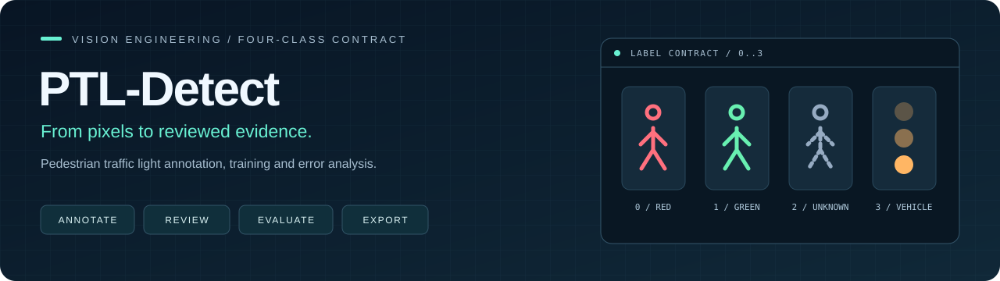
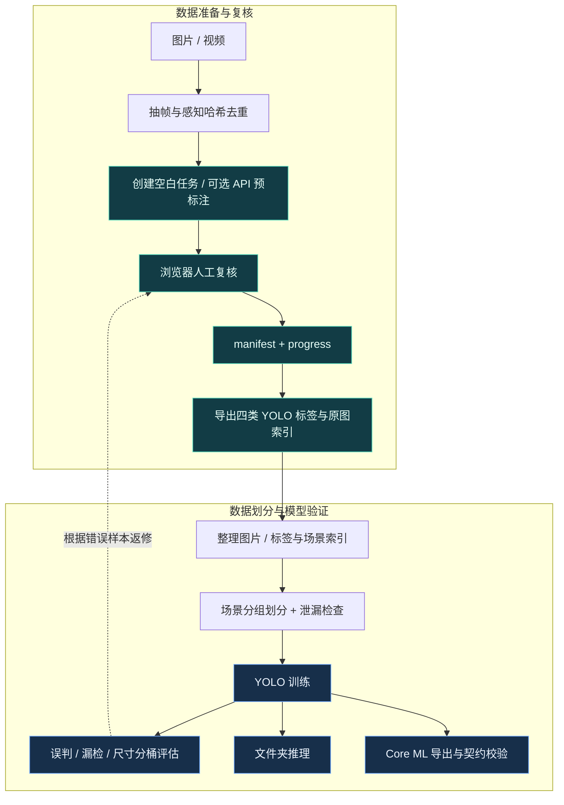
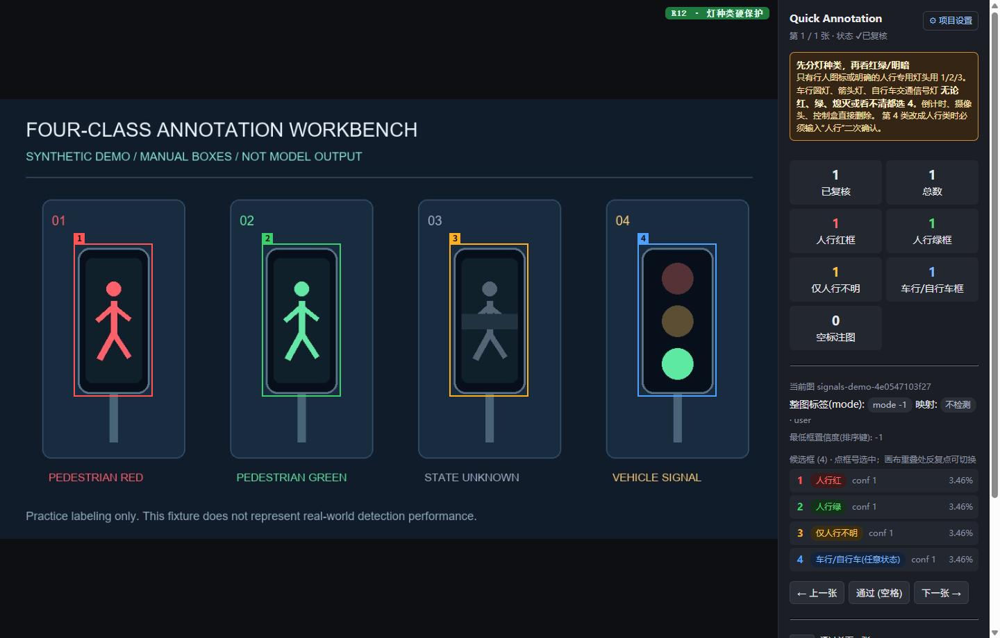

<p align="center">
  
</p>

# PTL-Detect

**行人信号灯视觉工具链：让标注可复核、数据划分可检查、关键误判可追踪。**

Pedestrian traffic light annotation, dataset preparation, YOLO training and error analysis.

[](https://github.com/utenkkekou/PTL-Detect/actions/workflows/tests.yml)


[](LICENSE)

信号灯识别的难点不只是找到一个亮点：车行绿灯可能被当作行人绿灯，同一段视频的相邻帧可能同时进入训练集和验证集，小目标与遮挡也会掩盖实际误判。PTL-Detect 将这些问题拆成可检查的数据契约、人工复核流程和专项评估脚本。

**[架构与数据流](#架构与数据流) · [功能展示](#功能展示) · [快速启动](#快速启动) · [训练与评估](#训练与评估) · [代码导航](#代码导航)**

| 工程问题 | 仓库中的实现 | 可检查的产物 |
| --- | --- | --- |
| 预标注需要人工纠错 | 本地浏览器画框、改类、逐图复核与进度保存 | `review_manifest.json` / `review_progress.json` |
| 数据划分可能泄漏相近场景 | 感知哈希检查、按场景分组划分、划分后重复检查 | 场景索引、训练 / 验证 / 测试划分 |
| 单一总指标掩盖关键错误 | 单独统计红→绿、车行灯→行人绿灯、漏检与目标尺寸分布 | Markdown 误判报告与进程退出码 |
| 训练和端侧标签可能错位 | 四类名称与顺序校验、Core ML 输出契约检查 | 类别顺序、NMS、`N×4` 输出维度 |

## 架构与数据流



这些环节通过文件交换结果，由独立脚本执行。复核进度与训练标签分开保存；标签导出后仍需按索引整理原图、标签和数据集配置。架构图中的返修箭头表示人工迭代流程。

## 功能展示

### 01 · 浏览器复核工作台

无需模型权重或 API Key 即可建立空白标注任务。可选 API 负责产生候选框，人工复核负责确认灯的种类与状态。示例图片见 [合成演示素材](docs/demo/signals-demo.png)，可用 [生成脚本](docs/demo/make_demo.py) 重建。



*本地运行截图，使用合成图片与手工标注框；图中的 `conf 1` 是手工框默认值，不是模型预测置信度。*

| 操作 | 交互与结果 |
| --- | --- |
| 新增 / 选择框 | 按 `R` 后拖拽画框；点击框或右侧列表选中 |
| 修改类别 | 选中后按 `1` / `2` / `3` / `4`，对应下表四类 |
| 删除与纠错 | 按 `D` 删除；车行灯改为行人灯需要输入“人行”确认 |
| 提交与继续 | 按空格标记已复核并前进；左右方向键翻页时也会保存 |
| 恢复进度 | 保存为 `review_progress.json`，再次载入同一任务可继续复核 |

编辑完成后请按空格或翻页保存，再关闭页面。实现见 [复核界面](tools/review/index.html) 与 [本地服务](tools/review/serve_review.py)。

### 02 · 四类标签契约

**先辨认灯的种类，再判断行人灯颜色。** 车行灯 / 自行车灯无论红、绿或暗灯，都属于第 4 类；“未知”只用于已确认的行人灯。

| 类别 ID | 快捷键 | 标签 | 标注含义 |
| --- | --- | --- | --- |
| `0` | `1` | `pedestrian_signal_red` | 行人红灯 |
| `1` | `2` | `pedestrian_signal_green` | 行人绿灯 |
| `2` | `3` | `pedestrian_signal_unknown` | 行人灯状态无法确认，如遮挡、过远或过渡状态 |
| `3` | `4` | `vehicle_signal` | 车行 / 自行车信号灯，作为独立类别 |

类别定义见 [ptl/constants.py](ptl/constants.py)。训练、评估与端侧导出校验类别名称和顺序，降低标签错位风险。

### 03 · 从数据质量到模型交付

- **复核完整性：** 标签导出默认拒绝未完成的任务和含有标签文件的输出目录，避免漏审样本或旧标签混入；无目标图片写为空标签。
- **场景隔离：** [划分脚本](scripts/split_dataset.py) 按场景分组，使用可用的位置、时间与场景索引，支持配置感知哈希合并阈值；优先保持场景完整，再平衡划分比例。[检查脚本](scripts/check_leakage.py) 用于重复与跨集合泄漏检查。
- **专项误判报告：** [评估脚本](scripts/eval_safety.py) 使用一对一 IoU 匹配，统计类别混淆、漏检、背景误报和目标尺寸分桶；单独检查两类“误判为行人绿灯”的错误。
- **导出契约：** [Core ML 导出器](scripts/export_coreml.py) 检查四类顺序、最终 NMS 和 `confidence` / `coordinates` 的末维，输出 `.mlmodel` 供后续端侧集成验证。

## 快速启动

准备 **Git、Python 3.10+**。以下流程只安装基础依赖，使用仓库内的合成图片完成一次人工复核，不需要 GPU、模型权重或外部 API。所有命令从仓库根目录运行。

<details open>
<summary><b>Windows · PowerShell</b></summary>

```powershell
git clone https://github.com/utenkkekou/PTL-Detect.git
cd PTL-Detect
python -m venv .venv
.\.venv\Scripts\python.exe -m pip install -e .
.\.venv\Scripts\python.exe -m tools.review.serve_review --host 127.0.0.1 --port 8000 --no-browser --config outputs/demo-config.json
```

</details>

<details>
<summary><b>macOS / Linux · Bash</b></summary>

```bash
git clone https://github.com/utenkkekou/PTL-Detect.git
cd PTL-Detect
python3 -m venv .venv
./.venv/bin/python -m pip install -e .
./.venv/bin/python -m tools.review.serve_review --host 127.0.0.1 --port 8000 --no-browser --config outputs/demo-config.json
```

</details>

打开 [本地工作台](http://127.0.0.1:8000)，按以下步骤操作：

1. 将“图片目录”设为本机仓库内 `docs/demo` 的**绝对路径**，“输出目录”设为仓库内 `outputs/demo-review` 的绝对路径。
2. 点击“创建空白任务”，待任务生成后点击“进入审核”。
3. 在四个示意灯头上分别按 `R` 拖拽画框，再按 `1`、`2`、`3`、`4` 设置对应类别。
4. 按空格提交。输出目录会包含任务清单 `review_manifest.json`、复核进度 `review_progress.json` 和预览图片。

演示图是人工绘制的合成素材，仅用于体验标注操作，不代表真实检测效果。替换为自己的 JPG / PNG 图片目录即可创建实际复核任务。

### 导出本次复核标签

完成整张图片复核后，保留服务运行，在另一个终端进入仓库目录执行：

**Windows：**

```powershell
.\.venv\Scripts\python.exe -m scripts.ptl_export_labels --images-dir docs/demo --manifest outputs/demo-review/review_manifest.json --progress outputs/demo-review/review_progress.json --out outputs/demo-labels
```

**macOS / Linux：**

```bash
./.venv/bin/python -m scripts.ptl_export_labels --images-dir docs/demo --manifest outputs/demo-review/review_manifest.json --progress outputs/demo-review/review_progress.json --out outputs/demo-labels
```

产物是 `outputs/demo-labels/labels/*.txt` 和 `ptl_index.csv`，**不复制原图**。标签文件以任务项 ID 命名，可通过 CSV 索引对应原图。重复演示时请换一个新的 `--out` 目录。未完成复核时脚本退出码为 `2`；`--allow-partial` 仅用于明确要导出已复核子集的场景。

<details>
<summary><b>可选：接入 API 预标注</b></summary>

在设置页填写兼容接口地址、模型与 API Key，再选择“使用 API 预标注”。这一步会向配置的服务发送图片。上面的启动命令将配置保存在本地 `outputs/demo-config.json`；不传 `--config` 时默认使用 `~/.quick-annotation/config.json`。请勿提交含密钥的配置。

候选框格式如下，左上角为原点，坐标范围为 `0–1000`：

```json
{"boxes": [{"label": "pedestrian_red", "bbox": [100, 120, 220, 360], "confidence": 0.95}]}
```

`label` 使用 `pedestrian_red`、`pedestrian_green`、`pedestrian_unknown` 或 `vehicle_signal`；无目标时返回 `{"boxes": []}`。预标注结果仍需人工复核。

</details>

## 训练与评估

以下是使用**自备数据**的独立流程。合成演示图用于验证标注操作，不构成训练集或精度基准。

复制 [configs/data.example.yaml](configs/data.example.yaml)，将 `path` 改为自己的数据集绝对路径，保留四类 `names` 的名称和顺序；图片与标签必须同名，目录结构如下：

```text
your-dataset/
├── images/{train,val,test}/
└── labels/{train,val,test}/
```

### 训练一次并生成评估报告

`--epochs 1` 用于检查训练流程能否跑通，不代表模型已经可用。默认初始化模型为 `yolo11n.pt`，Ultralytics 可能下载该权重；也可传入自己的 `--model` 路径。下面显式指定 CPU、较小批次和零数据加载子进程，便于本地试跑。

<details open>
<summary><b>Windows · PowerShell</b></summary>

```powershell
.\.venv\Scripts\python.exe -m pip install -e ".[train]"
.\.venv\Scripts\python.exe -m scripts.train --data configs/data.example.yaml --device cpu --epochs 1 --batch 2 --workers 0 --imgsz 640 --project runs/detect --name readme-smoke
.\.venv\Scripts\python.exe -m scripts.eval_safety --model runs/detect/readme-smoke/weights/best.pt --data configs/data.example.yaml --split val --out outputs/evaluation.md
```

</details>

<details>
<summary><b>macOS / Linux · Bash</b></summary>

```bash
./.venv/bin/python -m pip install -e ".[train]"
./.venv/bin/python -m scripts.train --data configs/data.example.yaml --device cpu --epochs 1 --batch 2 --workers 0 --imgsz 640 --project runs/detect --name readme-smoke
./.venv/bin/python -m scripts.eval_safety --model runs/detect/readme-smoke/weights/best.pt --data configs/data.example.yaml --split val --out outputs/evaluation.md
```

</details>

重复训练时输出目录可能自动递增，请以日志中的实际 `best.pt` 路径替换评估命令。GPU 训练可按环境修改 `--device`，正式实验需自行确定数据、轮数与硬件配置。

**如何读评估结果：** 默认在验证样本出现“行人红灯→行人绿灯”或“车行灯→行人绿灯”时返回退出码 `3`，可用于实验流水线检查。添加 `--report-only` 仍会执行真实模型推理，仅将这类失败的退出码改为 `0`，不代表检查通过。报告只描述所选数据集与阈值下的结果。

### 可选：Core ML 导出

需要训练完成的四类模型，以及兼容的 macOS / coremltools 环境。当前脚本会拒绝在 Windows 上执行。以下命令在 macOS 的仓库虚拟环境中运行：

```bash
./.venv/bin/python -m pip install -e ".[train,export-coreml]"
./.venv/bin/python -m scripts.export_coreml --weights runs/detect/readme-smoke/weights/best.pt --imgsz 960 --outdir models
```

输出 `models/PedestrianSignalIconDetector.mlmodel`。脚本进行模型格式与输出契约校验；实际设备上的延迟、识别效果与集成兼容性需另行测试。

## 代码导航

| 入口 | 职责 |
| --- | --- |
| [ptl/](ptl/) | 类别契约、标签 IO、框匹配与误判统计 |
| [tools/review/](tools/review/) | 浏览器复核、任务分段、进度持久化 |
| [api_pre_annotate.py](scripts/api_pre_annotate.py) | 图片发现、预览生成、空白任务 / 可选 API 候选框 |
| [video_to_dataset.py](scripts/video_to_dataset.py) | 视频抽帧、感知哈希去重与可选预标注 |
| [ptl_export_labels.py](scripts/ptl_export_labels.py) | 复核结果转四类 YOLO 标签与原图索引 |
| [split_dataset.py](scripts/split_dataset.py) / [check_leakage.py](scripts/check_leakage.py) | 场景划分、重复与泄漏检查 |
| [train.py](scripts/train.py) / [eval_safety.py](scripts/eval_safety.py) | 训练入口与专项误判报告 |
| [predict_folder.py](scripts/predict_folder.py) / [export_coreml.py](scripts/export_coreml.py) | 批量推理可视化与端侧模型导出 |
| [tests/](tests/) | 临时样例与 mock 测试，覆盖四类契约、复核、配置、标签 IO 与匹配逻辑 |

开发验证：安装 `.[dev]` 后执行 `python -m pytest -q`，其中 `python` 使用上文对应系统的虚拟环境解释器路径。[CI](.github/workflows/tests.yml) 在 Python 3.11 / 3.13 上运行测试。脚本参数以 `python -m scripts.<脚本名> --help` 为准；部分脚本保留了历史数据路径默认值，实际使用时应显式传入自己的路径。

## 发布范围与许可

本仓库提供工具源码、配置模板、测试与合成演示素材，不包含采集视频、真实训练数据、模型权重、密钥或现场识别效果承诺。自动化测试不等于真实场景精度验证；工具用于研究和评估，不能据此决定是否过街。

原创工具代码采用 [MIT License](LICENSE)。Ultralytics、Core ML 工具及模型 / 数据集分别遵循其自身条款，见 [第三方说明](THIRD_PARTY_NOTICES.md)。
